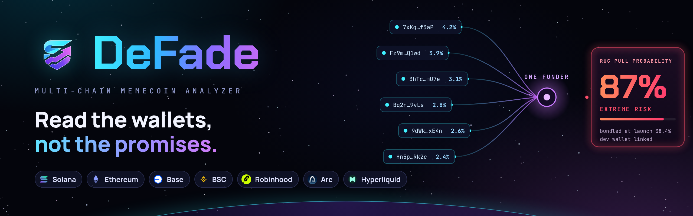
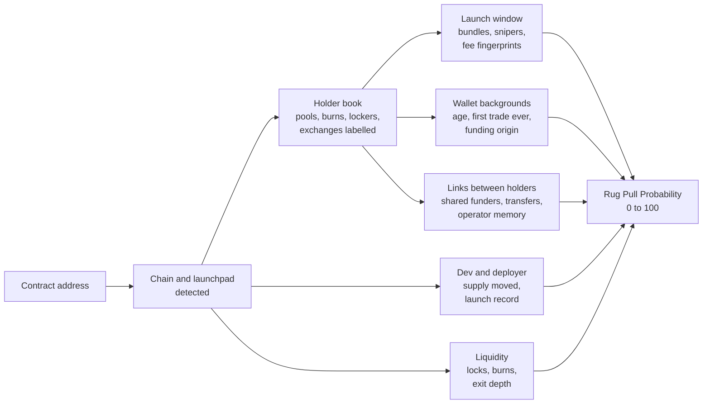
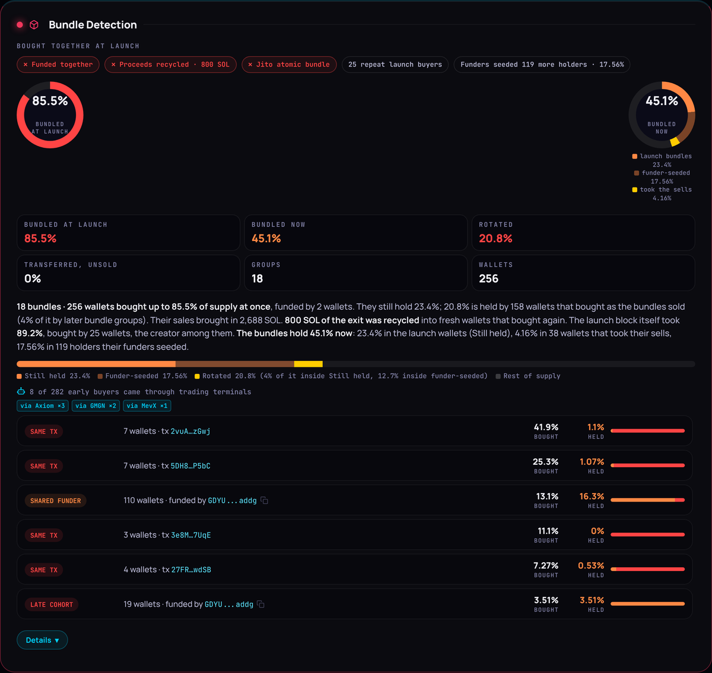
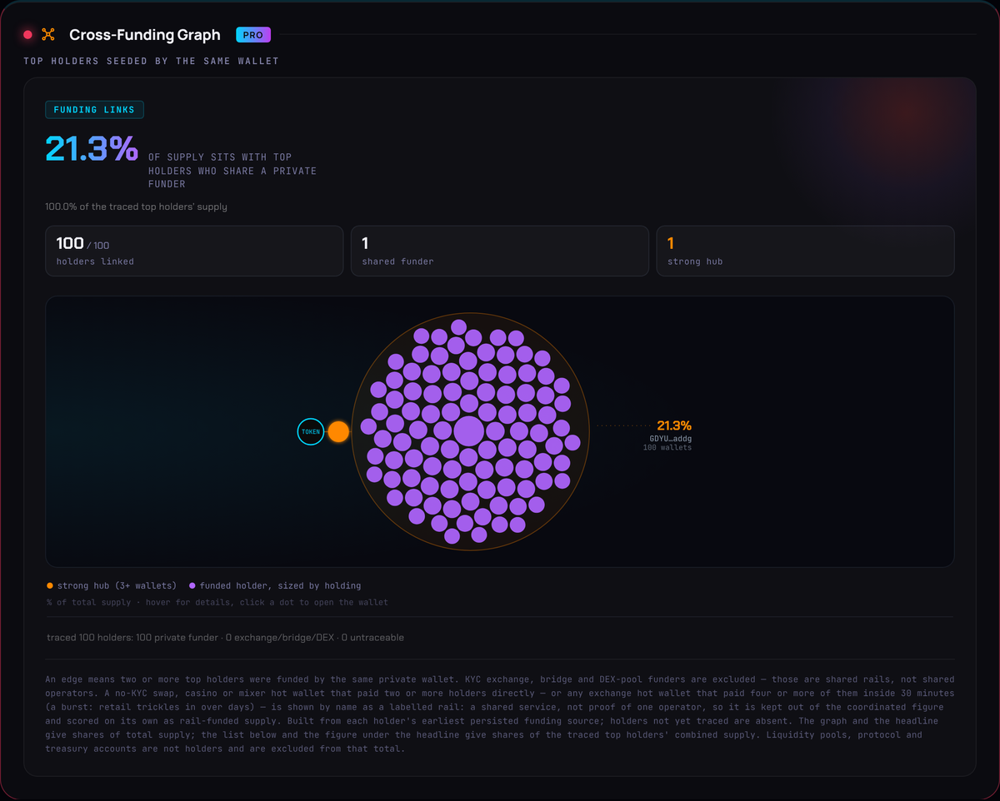
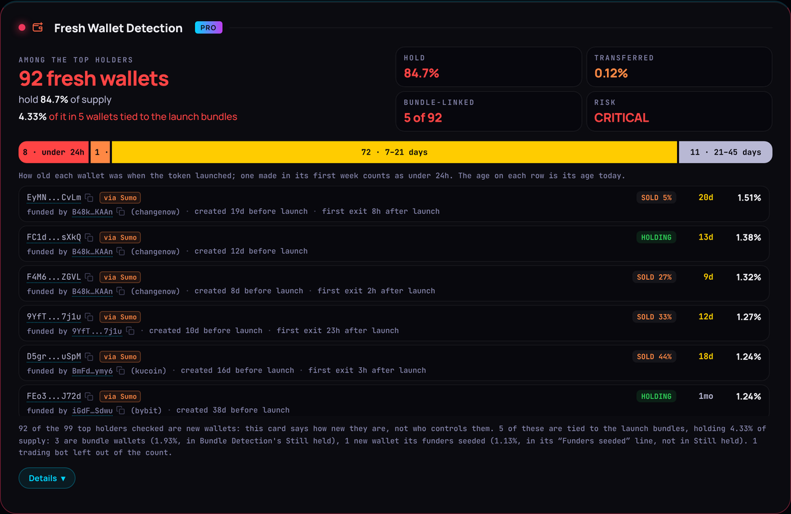
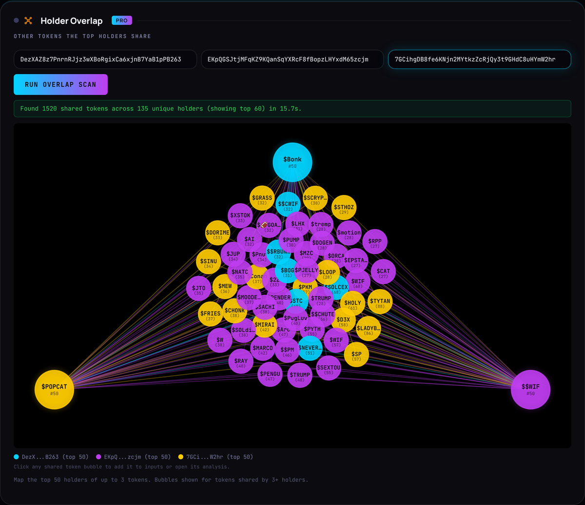
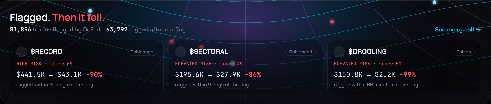

  

<h1 align="center">DeFade</h1>

  <b>The memecoin scanner that shows its work.</b> 
  Paste a contract address. Get a rug pull probability, and every wallet, funder and transaction behind it.

  <a href="https://defade.org"><b>defade.org</b></a> &nbsp;·&nbsp;
  <a href="https://t.me/DeFadeAnalyzerBot">Telegram bot</a> &nbsp;·&nbsp;
  <a href="https://defade.org/download">Apps and extension</a> &nbsp;·&nbsp;
  <a href="https://defade.org/api-docs">API</a> &nbsp;·&nbsp;
  <a href="https://defade.org/whitepaper">Whitepaper</a> &nbsp;·&nbsp;
  <a href="https://x.com/defade_">X</a>

> [!NOTE]
> **This is DeFade's public repository.** It holds the product documentation, how the verdict is built, the public API with working examples, and the place to report a wrong verdict or a bug. The scanning engine is closed source and runs at [defade.org](https://defade.org).

---

## The rug is not in the contract

On pump.fun and most launchpads, mint authority is revoked and there are no taxes by default. A contract check passes almost every launchpad token, including the ones that rug an hour later.

The risk lives in the wallets: who bought in the launch block, who funded them, which "independent" holders are one person, and what the dev did with their supply. That is the layer DeFade reads, scores and shows you.

> A clean contract tells you the rules can't change. It doesn't tell you who is holding.

## One paste, one verdict

Paste any token address. DeFade works out the chain and the launchpad on its own and returns:

- **A Rug Pull Probability from 0 to 100.** Higher means more of the rug pattern is present.
- **Every finding that moved it,** each with the points it added or took off, so you can see why the number is what it is.
- **The evidence behind every finding:** the wallets, their funders, the transactions and the share of supply involved.
- **A status line.** `FINAL SCORE` means every risk module has reported. `PROVISIONAL` names the modules still running, so you know when the number can still move.

| Chain | Launchpads recognised |
|---|---|
| **Solana** | pump.fun, Raydium LaunchLab (bonk.fun, StonkFun), Meteora DBC (Jupiter Studio, Bags, Believe, Printr), Boop.fun, MetaDAO |
| **Ethereum** | based.bid, Clanker, Doppler |
| **Base** | Clanker, Zora, Flaunch, Virtuals, Doppler (Bankr), based.bid, o1 |
| **BSC** | four.meme, flap.sh, Clanker, based.bid |
| **Robinhood** | Pons V2, Clank.trade, Pools.trade, Torch, Clanker, Doppler, based.bid, o1 |
| **Arc** | Argus, Tolly, Minara.fun, ubi.fun, Warp, Foci, Peach, Faze, based.bid, o1 |
| **Hyperliquid** | LiquidLaunch |

Tokens outside a launchpad are scanned the same way, from their pools.

## How a scan reads a token

Pools, burn addresses, lockers, exchange wallets and contracts are labelled first, so a pool or a locker is never mistaken for a whale. Modules run in parallel, and each one walks wallet histories under its own budget and deadline.

## What DeFade checks

35 modules on every chain, grouped by the question they answer.

| Question | Modules |
|---|---|
| **Who holds it?** | Holder Distribution · Whale Alert · Bubble Map · Holder Overlap and Wallet Overlap across up to three tokens · Notable Holders |
| **How did it launch?** | Bundle Detection: coordinated buys in the launch window (180 s on Solana, 300 s on EVM) plus a sweep of the first 24 hours · Historical Bundles · Sniper Bot Detection: buys in the first 120 s, split into instant and fast · Fee Fingerprint: wallets running one identical bot configuration |
| **Who is behind the wallets?** | Fresh Wallet Detection, with a virgin check for older wallets whose first token trade ever is this one · Funding Origin: the top 100 holders traced back to exchanges, swaps, bridges or mixers, by KYC tier · Sybil Bands: holders that share a private funder, collapsed into one band, with operator memory across launches · Holder Network: transfers and shared funders between the top holders · Cross-Funding Graph · Copy Trading Detection · Wallet Intelligence: wallets flagged by two or more independent modules |
| **What did the dev do?** | Dev Wallet Tracking · Deployer Reputation: every token the deployer launched, and how each one ended · Exit Playbook: how the same hands' earlier launches peaked and fell, and where this token is on that clock · Wallet Profiler · Token Lifecycle |
| **Can you get out?** | LP and Liquidity: burn and lock verification, including v3 and v4 positions · Exit Liquidity Calculator: price impact for a $100 to $100k sell, and the largest safe exit · Dump impact: the largest operator's whole position sold into the pool · Insider Profit Pressure: what the bundles and snipers paid against today's price · Position Stress Test: your buy, sold after the insiders sell first · Contract Safety (EVM) |
| **What is the market saying?** | Smart Money Tracker · Smart Money Signals · Social links · Social Sentiment timeline · X Community · AI summary |

A free account gets the 7 core modules on every scan, plus the headline figures of Bundle Detection and Token Snipers. Pro unlocks the other 27.

## Inside a scan

Real scans on [defade.org](https://defade.org), 24 October 2026.

<table>
  <tr>
    <td width="50%" valign="top"> <b>Bundle Detection</b>: the groups that bought together at launch and after, what they took and what they still hold</td>
    <td width="50%" valign="top"> <b>Cross-Funding Graph</b>: top holders seeded by the same private wallet</td>
  </tr>
  <tr>
    <td width="50%" valign="top"> <b>Fresh Wallet Detection</b>: wallets made around the launch, who funded them, and what they did since</td>
    <td width="50%" valign="top"> <b>Holder Overlap</b>: the tokens the top holders of up to three coins have in common (here BONK, WIF and POPCAT)</td>
  </tr>
</table>

## The verdict

The score adds up points from every finding. A safety finding, such as burned or locked liquidity, takes points off, but never more than half of them. The total lands in one of five bands:

| Score | Verdict |
|---|---|
| 0–24 | `PROBABLY SAFE` |
| 25–44 | `SOME RISK` |
| 45–59 | `ELEVATED RISK` |
| 60–74 | `HIGH RISK` |
| 75–100 | `EXTREME RISK` |

A weighted sum can be fooled by a launch that is clean everywhere except in the one place that matters. So some findings set a floor that no bonus can talk down:

- **Coordinated supply.** When holders tied together by strong shared funders control half or more of the top-holder supply, the score is never below **75**. At 40% or more, it is never below **55**.
- **Fresh wallets passing it on.** When three or more fresh wallets send on 90% or more of what they acquired, instead of selling it, the score is never below **75**.
- **Coordinated launch.** With half the supply bundled at launch the score is never below **45**, and with a quarter never below **25**. A coordinated launch is never "probably safe".
- **Dead tokens.** A collapse of 70% in an hour, 85% in six hours or 90% in a day, on a token under $5k in market cap or liquidity or less than a day old, reads `RUGGED / DEAD`. A token stuck under $5k after six hours reads `ABANDONED / DEAD`, or `NEVER BONDED` if it never left its bonding curve.

It works the other way too. An established token, old and large with deep liquidity, is capped at **19** unless its contract or liquidity is a live risk (mint or freeze authority active, liquidity unlocked or missing, the dev sold most of their supply) or a coordinated-supply floor fired.

**How to read it.** The score measures how much of the rug pattern is present today. It is not a countdown: a token at 80 can run for a week, and one at 20 can still be sold into. Read the findings under the number, because that is where the evidence is. Flagged tokens are filed in the public [Rug Database](https://defade.org/rugs) with the worst score ever taken on them.

## Shows its work

DeFade follows four rules:

- **One figure per fact.** The bundled share is computed once, by Bundle Detection. The score, the verdict and every other card that mentions it repeat that figure; none of them derives its own. When the groups' buys add up to more than the whole supply, the figure is the most they held at once, so no card ever reads "100% bundled".
- **Budgets that name what they skipped.** Every walk through wallet histories has a cap and a deadline. What a budget did not read is printed on the card, for example "bot · first 2,000 of 21,996 tx read", and never turns into a quieter verdict.
- **Honest gaps.** A data source that doesn't answer is reported as missing on the card. DeFade never guesses the gap.
- **Final means final.** The score says when it is still provisional, and which module it is waiting for.

## Flagged. Then it fell.

  

[Called It](https://defade.org/called-it) lists tokens that DeFade flagged at 45 or more at least 30 minutes before they collapsed, with the score and market cap at the first scan and now. On 24 October 2026 the homepage counted 81,896 tokens flagged by DeFade, 63,792 of which rugged after the flag.

## Everywhere you trade

| Where | What you get |
|---|---|
| **[defade.org](https://defade.org)** | The full scan, every module, nothing to install |
| **[Chrome extension](https://chromewebstore.google.com/detail/defade-%E2%80%94-solana-rug-pull/omcpnfjfaedbkakmnmbfjfmdnbpninof)** | A risk badge next to tokens on trading terminals, explorers and charts, and a side panel to scan without leaving the page |
| **[iOS](https://apps.apple.com/gb/app/defade/id6760209482) and [Android](https://play.google.com/store/apps/details?id=org.defade.app)** | The scanner on your phone |
| **[Telegram bot](https://t.me/DeFadeAnalyzerBot)** | `/scan` any token on any chain. With Pro, Crew Radar (`/radar on`) alerts you when hands DeFade has seen before launch a new token on pump.fun, bonk.fun and the other Raydium LaunchLab launchpads, Meteora's bonding curve (Jupiter Studio and others) or boop.fun, or on four.meme, flap.sh, Clanker, Zora and the Pons launchpads on BSC, Base, Ethereum, Robinhood and Arc, with where their launches usually peaked, and `/top` follows a token to that peak |
| **[REST API](https://defade.org/api-docs)** | 30 endpoints, every chain on every plan; a free 7-day trial key opens six of them |
| **[MCP connector](https://defade.org/api-docs#mcp)** | AI assistants run real DeFade scans inside the conversation: 15 read-only tools at `https://api.defade.org/mcp` |

## Beyond the scan

- **[Rug Database](https://defade.org/rugs)**: every flagged token, with the worst score ever taken on it, searchable by chain.
- **[Called It](https://defade.org/called-it)**: the flags that came true, with the numbers then and now.
- **[Survival Tracker](https://defade.org/survival)**: how many memecoins survive past 1 hour, 6 hours, 24 hours and beyond.
- **[Rug Heatmap](https://defade.org/heatmap)**: the hours of the day when high-risk and bundled launches cluster.
- **[Deployer Lookup](https://defade.org/deployer-lookup)**: everything a deployer launched, how much of it survived, and its rug history.
- **[Wallet Lookup](https://defade.org/wallet-lookup)**: a wallet's holdings with their rug risk, its trades, win rate and PnL, and the rugs it took part in.
- **[KOL Leaderboard](https://defade.org/kol-leaderboard)** and **[Caller Tracker](https://defade.org/callers)**: which influencer wallets are actually winning, and how their calls went.
- **Portfolio Scanner**, **Token Comparison** and a **Watchlist** with alerts.

## Plans

| | Free | Pro | Gold |
|---|---|---|---|
| **Price** | $0 | $24 a month | $99 a month |
| **Scans** | 3 tokens a day | 300 a month | 2,500 a month |
| **Modules** | 7 core modules, plus the bundle and sniper headlines | All 35 | All 35 |

A scan is one token: an EVM token counts as two, and once scanned, everything on that token is free for 24 hours. New subscribers get a 7-day free trial. Pay by card or in USDC on Solana. Full details on the [pricing page](https://defade.org/pricing).

## Under the hood

- **Chain-native on every chain.** Solana is read from parsed transactions. EVM chains are read from archive RPC and block explorer indexes, with public endpoint failover per chain. One UI covers all seven.
- **Parallel, with a budget on everything.** Modules run side by side. Every wallet walk has a cap and a deadline, and results are cached between scans.
- **A small stack.** A Node.js API, PostgreSQL, and a web frontend with no build step. The same frontend runs as the iOS and Android apps.
- **Tested before it ships.** About 3,000 automated tests run on every change, and nothing merges until they pass.
- **Read-only by default.** A scan never needs your wallet or your keys. Trading is optional: you sign in your own wallet, with MEV-protected execution through Definitive and instant swaps through Jupiter on Solana.

## Roadmap

From the [whitepaper](https://defade.org/whitepaper#roadmap).

**Shipped**

- [x] Solana, Ethereum, Base, BSC, Robinhood, Arc and Hyperliquid, with the EVM modules rebuilt chain-native for full parity
- [x] Signal Fusion in the risk score: wallets flagged by independent modules count together
- [x] Operator memory, the virgin wallet check, and a circulating-float basis for holder figures
- [x] Wallet Reputation database: repeat offenders recognised on sight
- [x] Deployer Lookup, Wallet Lookup, Caller Tracker and KOL Leaderboard
- [x] Telegram watchlist alerts: liquidity pulled, dev sells, whale dumps
- [x] Rug Receipts and the Called It feed: the flags that came true, with the numbers
- [x] A page for every scanned token, on every chain
- [x] The MCP connector for AI assistants
- [x] The public API on every chain, Solana and EVM
- [x] iOS, Android, the Chrome extension and the Telegram bot
- [x] Notable Holders on the EVM chains
- [x] Extension overlays: a DeFade risk badge on the trading platforms you already use
- [x] Trader tools: Exit Playbook, Insider Profit Pressure and Position Stress Test
- [x] Crew Radar on Telegram: an alert when known hands launch, and at their usual top
- [x] The trader tools on the API and on the extension badge

**In progress**

- [ ] DeFade Signals: a discovery feed that surfaces evidence of real attention, never buy calls (internal testing)
- [ ] Quick snipe checker, multi-wallet dashboard and a webhook API

**Next**

- [ ] More EVM chains, Arbitrum first
- [ ] Directory listings and hosted sign-in for the MCP connector, on its 15 tools
- [ ] Push notifications and real-time alerts
- [ ] Token comments and community notes
- [ ] Daily and weekly rug reports
- [ ] And much more

---

<b>Every rug leaves a trail. DeFade follows it.</b>

## In this repository

| Path | What is in it |
|---|---|
| [`docs/modules.md`](docs/modules.md) | Every module: what it shows and how to read it |
| [`docs/api.md`](docs/api.md) | The public REST API: keys, chains, units, endpoints, errors |
| [`docs/mcp.md`](docs/mcp.md) | Connecting DeFade to an AI assistant over MCP |
| [`docs/telegram-bot.md`](docs/telegram-bot.md) | The Telegram bot's commands and alerts |
| [`examples/`](examples) | Working API clients in curl, Node.js and Python, with no dependencies |
| [Issues](../../issues/new/choose) | Report a verdict that looks wrong, a bug, or suggest a signal, chain or launchpad |

Found a security problem? Please don't open an issue; see [SECURITY.md](SECURITY.md).

## License

The code in [`examples/`](examples) is MIT licensed: use it however you like. Everything else in this repository, including the text, images and the DeFade name and logo, is © 2026 DeFade Ltd, all rights reserved. See [LICENSE](LICENSE).

DeFade Ltd is registered in England and Wales, Company No. 17136143. DeFade reports on-chain evidence; it is not financial advice.
